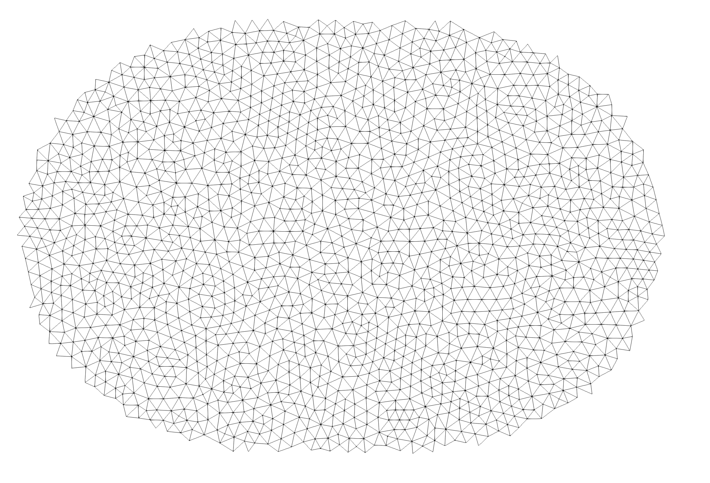

# SGRAC
Spatial coupling of slip gradient and rupture acceleration on fine-scale unstructured meshes

by A. Herrero (INGV) and S. Murphy (IFREMER)

SGRAC is an exploratory research project aimed at testing how spatial properties of earthquake slip distributions, especially slip gradients, may control rupture propagation on complex fault meshes.

The project focuses on kinematic rupture modeling on irregular unstructured meshes. Its long-term goal is to provide a lightweight, open, reproducible toolchain for generating rupture-time fields from physically motivated relationships between slip structure and rupture velocity.

## Scientific motivation

High-frequency seismic radiation is strongly affected by the spatial and temporal complexity of rupture propagation. In dynamic rupture simulations, rupture history emerges from the physical model. In kinematic source modeling, however, rupture velocity must usually be prescribed in advance.

Existing kinematic approaches often use simple rupture-velocity assumptions, such as constant velocity or weak empirical correlations with slip. SGRAC explores a different idea: rupture velocity may be controlled not only by slip amplitude, but also by the local geometry of the slip field.

A key hypothesis is that rupture propagation can be influenced by the directional relation between the rupture-front normal and the slip-gradient vector:

$$
V_r \sim f(\nabla S \cdot \mathbf{n}_r)
$$

This allows the rupture to interact with slip patches in a directional way. For example, rupture may slow when entering a high-slip asperity while being able to propagate around it with less perturbation.

## Core idea

The project investigates rupture propagation on a fault represented by a triangular unstructured mesh.

The workflow combines:

- self-affine or smooth slip distributions on irregular fault geometries;
- rupture-front propagation using an eikonal/Huygens-type approach;
- rupture-velocity laws coupled to slip, slip gradient, or directional slip gradient;
- diagnostic metrics describing rupture-time fields and rupture-front geometry.

The first development stage deliberately avoids waveform or radiation metrics. The initial focus is on rupture geometry, rupture timing, and the behavior of the propagating front.

## Expected research product

The intended research product is an open-source codebase combining:

- Fortran kernels for the rupture-time computation;
- Python tools for mesh preparation, slip generation, diagnostics, and visualization;
- reproducible examples;
- documentation;
- eventually, a Docker container for easier reuse.

The code will rely only on open-access resources and is intended to be released publicly on GitHub.

## Development roadmap

### Basic principles

- Pipable fortran module
- use of Forparse (input), trilat-time (huygens principle), trilat-distance (geodetic distance) and k223d (k-square slip + rupture time) modules
- legacy ASCII VTK format for the interfaces between modules

### Phase A — Mesh and geometry tools <span style="color:green">✔</span>

- Generate a large parent triangular mesh. <span style="color:green">✔</span>
- Extract irregular rupture domains. <span style="color:green">✔</span>
- Compute geodesic distances. <span style="color:green">✔</span>
- Define local angular coordinates. <span style="color:green">✔</span>
- Normalize rupture area to an Mw 6.5 target. <span style="color:green">✔</span>

Here a workflow example for a flat surface generated by `sgrac-gmsh-support`:

```bash
sgrac-gmsh-support lx=120000 lz=80000 lc=500 |
sgrac-geometry geometry=foci_ellipse focus1_node=10 focus2_node=200 |
sgrac-mask geometry=foci_ellipse mw=6.0 stressdrop=3.0e6 |
sgrac-extract > rupture.vtk
```




### Phase B — Slip models <span style="color:green">✔</span>

- Implement smooth Gaussian slip. <span style="color:green">✔</span>
- Implement self-similar rough slip modulated by a Gaussian envelope. <span style="color:green">✔</span>
- Normalize slip to the target scalar moment. <span style="color:green">✔</span>

### Phase C — Rupture propagation

- Implement baseline constant-velocity rupture propagation. <span style="color:green">✔</span>
- Add slip-dependent velocity laws.
- Add gradient-based velocity laws.
- Add directional-gradient velocity laws.

### Phase D — Diagnostics

- Compute rupture-time metrics.
- Extract and analyze rupture fronts.
- Compare smooth and rough slip cases.
- Evaluate sensitivity to boundary shape and velocity law.

### Phase E — Release preparation

- Clean code structure.
- Add examples.
- Add documentation.
- Prepare reproducible workflows.
- Provide containerized execution.

## Project status

Phase C

During elaboration of Phase A, we have also decided to use a second set of example on a non planar fault: the Scotia slab.

## Nota

The project is exploratory by design. The first objective is not to provide a final rupture theory, but to test whether geometric properties of slip fields contain useful information for constructing realistic rupture-time fields on complex fault meshes.
