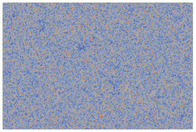
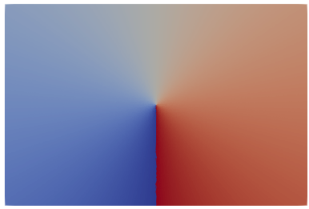
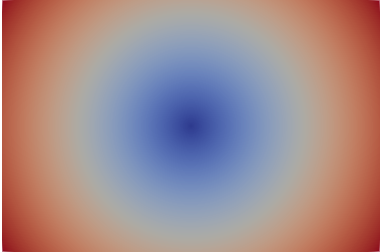
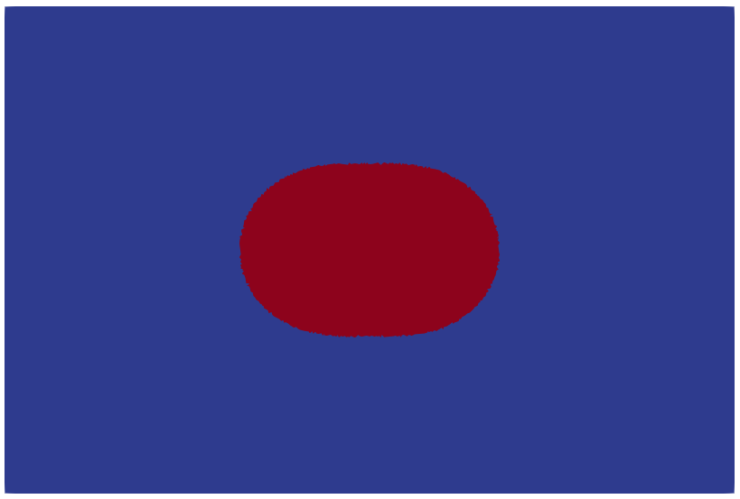
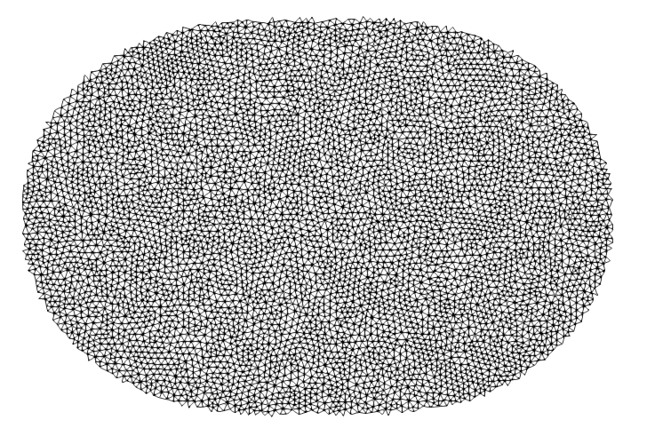
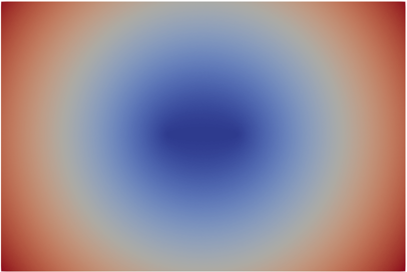

# rectangular mesh example

As every seismologist knows, a fault is a flat rectangle with a ratio 2:1.

## step up

All the binary are inside `$HOME_SGRAC/bin` and this directory belongs to your `$PATH`


## slip building

### sgrac-gmsh-support

We use first the `sgrac-gmsh-support` to mesh a rectangle of length `lx` and width `lz` with
a spacing dimension `lc`. It is using the GMSH api.

```bash
sgrac-gmsh-support lx=120000 lz=80000 lc=500 > parent.vtk
```

The center of the "fault" is an embedded node, with `id=0` and coordinates `(0,0,0)`

### sgrac-geometry - sgrac-mask - sgrac-extract

#### using theta_ellipse

The next step is the computation of different fields on the mesh in order to prepare the 
extraction of a sub-mesh associated to a given magnitude earthquake.

The key factor here is the shape of this sub-fault. In real complex fault surfaces, define a
rectangle is not an easy task. However considering the earthquake rupture surface as a rectangle
has not really a meaning anymore with unstructured meshes.

The first possibility is to consider a anisotropic contour function depending on theta.

```bash
sgrac-geometry source=1 < parent.vtk > geom_theta_ellipse.vtk
```

This command computes different fields on the surface such as the area of each cell and
other fields related to the reference node for the geometry such as the angle with the
vertical projected on the fault respect to downward `z` direction (depth) or the geodetic
distance to the reference node.

<table border="0">
  <tr valign="middle">
    <td align="center" width="33%"></td>
    <td align="center" width="33%"></td>
    <td align="center" width="33%"></td>
  </tr>
  <tr valign="middle">
    <td align="center" width="33%">area</td>
    <td align="center" width="33%">theta</td>
    <td align="center" width="33%">distance</td>
  </tr>
</table>

using the fields compute with `sgrac-geometry`, a mask is computed for a target magnitude and
stress drop. The anisotropy of the mask may also be changed in the command line

```bash
sgrac-mask model=ellipse mw=7.0 stressdrop=3.0e6 anis=0.2 < geom_theta_ellipse.vtk > masked_theta_ellipse.vtk
```

<table border="0">
  <tr valign="middle">
    <td align="center" width="33%"></td>
    <td align="center" width="33%"></td>
    <td align="center" width="33%"></td>
  </tr>
  <tr valign="middle">
    <td align="center" width="33%"></td>
    <td align="center" width="33%">mask for Mw 7.0</td>
    <td align="center" width="33%"></td>
  </tr>
</table>

The last step of this sub-event definition is the extraction of the submesh:

```bash
sgrac-extract < masked_theta_ellipse.vtk > rupture.vtk
```

<table border="0">
  <tr valign="middle">
    <td align="center" width="33%"></td>
    <td align="center" width="33%"></td>
    <td align="center" width="33%"></td>
  </tr>
  <tr valign="middle">
    <td align="center" width="33%"></td>
    <td align="center" width="33%">submesh for Mw 7.0</td>
    <td align="center" width="33%"></td>
  </tr>
</table>

#### using foci_ellipse

An alternative to theta_ellipse for the definition of the shape of the subnet is the definition of
an ellipse through the position of two foci. The resulting shape is less "squared" than the previous
method but it is more stable because it does not rely on the computation of an angle. 

Though it is preferable to choose this approach if the theta field computed by `geometry model=ellipse`
is unstable because a part of the mesh is sub horizontal.

The shape of the sub-mesh is then controlled by the geodetic distance between the two foci.

```bash
sgrac-geometry geometry=foci_ellipse focus1_node=18550 focus2_node=8375 < parent.vtk  > geom_foci_ellipse.vtk
```

In this line, we have used Paraview on parent.vtk to arbitrarily select two nodes. Add 1 to the Id numbers
found in Paraview.

<table border="0">
  <tr valign="middle">
    <td align="center" width="33%"></td>
    <td align="center" width="33%"></td>
    <td align="center" width="33%"></td>
  </tr>
  <tr valign="middle">
    <td align="center" width="33%"></td>
    <td align="center" width="33%">sum of the geodetic distances from the two foci</td>
    <td align="center" width="33%"></td>
  </tr>
</table>
